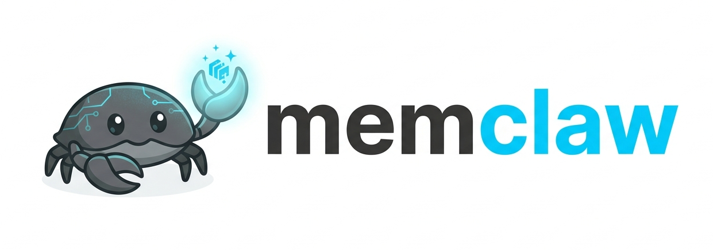
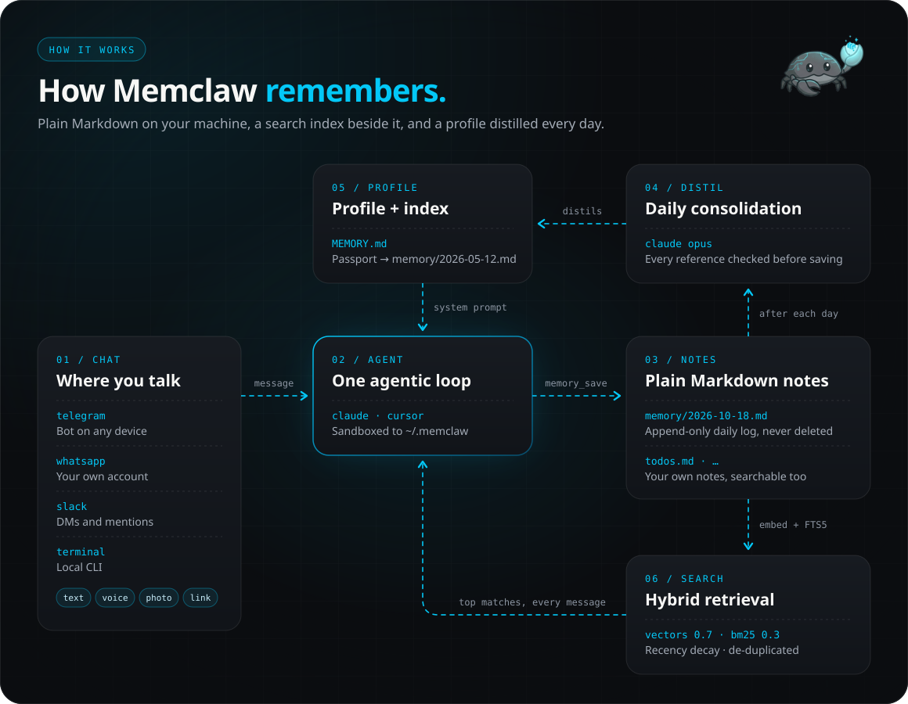

<div align="center">



### Text it anything. Ask for it months later.

A personal memory assistant that lives in Telegram, WhatsApp, Slack or your terminal,<br>and keeps everything you tell it as plain Markdown on your own machine.

[](https://pypi.org/project/memclaw/)
[](https://github.com/emanuilo/memclaw/actions/workflows/ci.yml)
[](https://www.python.org/downloads/)
[](LICENSE)

<a href="docs/assets/memclaw-demo.mp4"></a>

</div>

---

## Why Memclaw

- **It finds things you only half remember.** Hybrid vector + keyword search, so *"that restaurant Alex mentioned"* works without the exact words. Photos, voice notes and links are searchable too.
- **It lives where you already type.** Telegram, WhatsApp (your personal account — no Meta Business setup, no webhooks, no public server), Slack, or the terminal. No new app to open.
- **Your memories are files you own.** Plain Markdown in `~/.memclaw/` — read them, edit them, grep them, put them in git. SQLite is just the index.
- **It runs on the Claude plan you already pay for.** Use a Claude Pro/Max/Team subscription, or an API key, or Cursor.
- **It can't touch the rest of your computer.** The agent gets no shell, no built-in file tools, none of your Claude settings, plugins or MCP servers — only Memclaw's own tools, and their file access is path-checked to `~/.memclaw/`.
- **Small and cheap to run.** Python and SQLite. No Postgres, no vector database, no server to expose. Docker is optional.

## Quick Start

You need Python 3.10+, an **OpenAI API key** (embeddings, voice, link summaries) and a **Claude subscription or Anthropic API key** (or a Cursor API key).

```bash
pip install memclaw
memclaw
```

The setup wizard asks where you want to talk to Memclaw — **Telegram**, **WhatsApp**, **Slack** or **Terminal** — and asks only for the keys that choice needs. From then on, `memclaw` starts that front-end. `memclaw configure` changes it later.

- Per-platform setup (BotFather, WhatsApp pairing, the Slack manifest): [docs/platforms.md](docs/platforms.md)
- Running it 24/7 on a server: [docs/docker.md](docs/docker.md)
- Upgrading from 2.x: [docs/upgrading.md](docs/upgrading.md)

## What you can send it

Just talk to it. No commands, no folders, no tags — the agent works out what to keep and how to find it again.

| | You send | Memclaw | Later, you ask |
|:-:|---|---|---|
| 💬 | **Text** — a fact, a decision, a passing thought | Saves what matters (and skips "ok thanks"), rephrasing messy messages | *"What did I decide about the lease?"* |
| 🎙️ | **Voice notes** | Transcribes them with Whisper and saves the content like text | *"What was that idea I had on my run?"* |
| 🖼️ | **Photos** — receipts, whiteboards, documents | Describes the image in detail and indexes the description | *"Send me my passport photo"* — and gets the photo back |
| 🔗 | **Links** | Fetches the page and saves a summary with the URL | *"That article about distributed databases"* |
| ⏰ | **Reminders** — *"every Monday at 9"*, *"tomorrow at 6pm"* | Schedules one-shot or recurring reminders | They arrive in the same chat |
| 📝 | **Lists and files** — *"keep my todos in todos.md"* | Maintains your own notes inside the vault, searchable like everything else | *"What's left on my todo list?"* |
| 🧭 | **Preferences** — *"always reply in Spanish"* | Remembers how you want it to behave, in every future chat | — |

Voice works in Telegram, WhatsApp and Slack; in the terminal you save a photo by giving its path. Setup for each app is in [docs/platforms.md](docs/platforms.md).

## How memory works

Most "AI memory" either stuffs everything into the prompt or retrieves a few snippets and hopes. Memclaw does both, deliberately:

<p align="center">
  
</p>

1. **Everything lands in a daily note.** Daily notes are append-only and never deleted — they are the complete record.
2. **Every message is searched against your memories.** The top matches ride along with the message, so the agent usually knows the answer before it calls a tool. Search blends embeddings (70%) with BM25 keywords (30%), favors recent notes (30-day half-life) and drops near-duplicates.
3. **Once a day is over, it's distilled into `MEMORY.md`:** a short profile of you (people, work, health, plans, open threads) plus an **index** that points into the notes — `- Car insurance policy and claim number → memory/2026-05-12.md`. Every reference is checked against the files before saving, and the previous version is kept in `.history/`.
4. **`MEMORY.md` is in every conversation; the details aren't.** Ask for your policy number and the agent follows the reference and reads the note. Secrets and document numbers stay out of the prompt until you ask for them.

Each chat is also one ongoing conversation that survives restarts; send `/new` to start fresh — your memories stay.

The full design — chunking, search pipeline, consolidation rules, caching — is in [Memory Architecture](docs/memory-architecture.md).

## What's on your machine, and what isn't

Memclaw is local-first, not offline. Here's exactly where your data goes:

| Where | What |
|-------|------|
| **Your machine** (`~/.memclaw/`) | All memories as Markdown, the search index, reminders, conversation ids, and photos sent via WhatsApp or Slack. Links are fetched from your machine. |
| **OpenAI** | Memory text and messages for embeddings, voice messages for transcription, fetched page text for link summaries. |
| **Anthropic** (or **Cursor**) | Your messages and photos, `MEMORY.md`, the matching memory snippets, notes the agent opens, and the past day's notes during consolidation. |
| **Your chat app** | The conversation itself, as with any bot. Telegram photos stay on Telegram; Memclaw keeps a reference and a description. |

Memclaw itself sends nothing anywhere else.

## Configuration

The wizard covers everything most people need. For agent backends and models, every environment variable and the vault layout, see [docs/configuration.md](docs/configuration.md).

`memclaw save`, `search`, `status`, `consolidate` and `doctor` also work straight from the shell ([details](docs/platforms.md#direct-commands)), and the store and search can be [used as a library](docs/library.md).

## Contributing

Issues and PRs are welcome — see [CONTRIBUTING.md](CONTRIBUTING.md).

## License

MIT — see [LICENSE](LICENSE).

## Acknowledgments

- [OpenClaw](https://github.com/openclaw/openclaw), for the idea that started it all
- [`claude-agent-sdk`](https://pypi.org/project/claude-agent-sdk/) and [`cursor-sdk`](https://pypi.org/project/cursor-sdk/) for the agent runtime
- [`neonize`](https://github.com/krypton-byte/neonize) for WhatsApp
- [SQLite FTS5](https://www.sqlite.org/fts5.html) for full-text search
